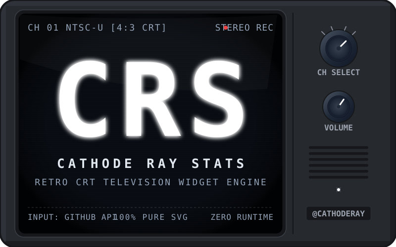

# CathodeRayStats

<p align="center">
  
</p>

<p align="center">
  <a href="https://cheese-cheese.github.io/CathodeRayStats/"></a>
  <a href="https://github.com/marketplace/actions/cathoderaystats"></a>
  <a href="https://github.com/features/actions"></a>
  <a href="https://github.com"></a>
  <a href="https://opensource.org/licenses/MIT"></a>
</p>

**CathodeRayStats** is an animated, zero-runtime-dependency GitHub Action that generates an authentic **Retro CRT Television SVG** displaying your live statistics across **4 cycling channels**.

Self-contained inside a single SVG with embedded `VT323` pixel terminal typography, light analog static noise texture, and pure CSS `@keyframes` animations—fully compatible with GitHub's `camo.githubusercontent.com` image proxy.

<p align="center">
  
</p>

---

## The 4 Channels

The television cycles through four retro channels (default 4 seconds per channel, 16s total cycle), accompanied by an analog CRT static transition flash and a synchronized rotating **CH rotary knob**:

| Channel | Screen View | Content Displayed |
| :--- | :--- | :--- |
| **Channel 1** | **SYSTEM STATS** | Total contributions (past year), commits, pull requests, and followers. |
| **Channel 2** | **TOP LANGUAGES** | Top 5 languages by byte count visualized with segmented phosphor progress ticks (`||||||||`). |
| **Channel 3** | **NOW SHOWING** | Spotlight on your top repository (or configured featured repo) with description, stars, and forks. |
| **Channel 4** | **ACTIVITY RADAR** | 26-week x 7-day contribution heatmap grid with density legend and 6-month total count. |

> **Prefer a static channel?** Set `channel: '1'` (or `'2'`, `'3'`, `'4'`) in your workflow to freeze the display on a single static screen without animation.

---

## Quick Start (3-Step Setup)

### Step 1: Create the GitHub Workflow

In your repository, create `.github/workflows/cathoderaystats.yml`:

```yaml
name: CathodeRayStats

on:
  schedule:
    - cron: '23 */6 * * *' # Every 6 hours
  workflow_dispatch:      # Manual trigger button in GitHub Actions tab

permissions:
  contents: write         # Allows the action to commit & push the updated SVG

jobs:
  cathoderaystats:
    runs-on: ubuntu-latest
    steps:
      - name: Checkout repository
        uses: actions/checkout@v4

      - name: Update CathodeRayStats
        uses: Cheese-Cheese/CathodeRayStats@v1
        with:
          username: ${{ github.repository_owner }}
          tv-color: charcoal      # charcoal, walnut, beige, mustard, crimson, navy, or #hex
          screen-color: white     # white, yellow, green, cyan, magenta, orange, or #hex
          knob-type: line         # line or dot
          show-antennas: false    # Set to true for rabbit-ear antennas
```

### Step 2: Run the Workflow Once

Before embedding the image into your profile, manually trigger the workflow once to generate the initial SVG:

1. In your GitHub repository, click on the **Actions** tab.
2. In the left sidebar under *All workflows*, select **CathodeRayStats**.
3. Click the **Run workflow** dropdown on the right, keep the branch as `main`, and click **Run workflow**.
4. Once the job completes (~30 seconds), GitHub Actions will commit `dist/retro-tv.svg` directly to your repository.

### Step 3: Embed the SVG in your README

Add this snippet anywhere in your `README.md`:

```markdown
<p align="center">
  
</p>
```

From here on, GitHub Actions will automatically refresh your live stats every 6 hours and push updates to `dist/retro-tv.svg`.

### Advanced (Optional): Match Your Local Timezone

By default, the activity heatmap (Channel 4) aligns with UTC (`timezone-offset-minutes: 0`). If you want the contribution radar to match your local calendar day, pass `timezone-offset-minutes` to your workflow (e.g. `330` for IST, `-300` for EST, `-480` for PST, `540` for JST):

```yaml
        with:
          username: ${{ github.repository_owner }}
          timezone-offset-minutes: 330 # (Optional) UTC offset in minutes
```

> [!TIP]
> Need to check your exact timezone offset? You can find your offset in minutes using [World Time Buddy](https://www.worldtimebuddy.com/).

---

## Mix-and-Match Any Combinations

You can freely mix and match any screen color with any TV cabinet color, chassis style, antenna configuration, and channel mode:

- **Any named preset combination:** e.g., White screen on Walnut TV, Cyan screen on Crimson TV, Amber screen on Charcoal TV, Green screen on Beige TV.
- **Any custom hex colors:** Pass `#RRGGBB` hex strings to `screen-color` and `tv-color`. The engine automatically generates CRT glass background tints, highlights, shadows, and phosphor glow.
- **TV chassis styles:** `'classic'` (rounded vintage corners) or `'trinitron'` (boxy studio monitor).
- **Rabbit-ear antennas:** `show-antennas: true` to mount telescoping metallic antennas on top.
- **Single channel display:** `channel: '1'` (stats only), `'2'` (languages only), `'3'` (repo spotlight only), or `'4'` (activity only).

Example custom configuration:

```yaml
- uses: Cheese-Cheese/CathodeRayStats@v1
  with:
    username: my-github-handle
    tv-color: "#18181B"          # Custom dark zinc chassis
    screen-color: "#00FFCC"      # Custom bright mint phosphor
    tv-style: trinitron          # Boxy monitor chassis
    show-antennas: true          # Telescoping rabbit-ear antennas
    knob-type: dot               # line or dot
    channel: all                 # Cycle all channels
    channel-duration: 5          # 5 seconds per channel
    badge-label: "@PRO-DEV"      # Custom text on the bottom chassis badge
```

---

## Theme Presets Reference

### Phosphor Screen Presets (`screen-color`)

| Preset | Vibe | Primary Phosphor | CRT Background |
| :--- | :--- | :--- | :--- |
| **`white`** *(Default)* | Classic B&W P4 Monochrome CRT | `#E2E8F0` | `#0A0E14` |
| **`yellow` / `amber`** | Vintage IBM / Zenith P3 Amber Terminal | `#FFB000` | `#140D02` |
| **`green`** | Classic Apple II P1 Phosphor | `#4AF626` | `#051205` |
| **`cyan`** | Halcyon / Sci-Fi Terminal | `#00F0FF` | `#03141A` |
| **`magenta` / `pink`** | Outrun / Synthwave CRT | `#FF4D88` | `#14030A` |
| **`orange`** | 1980s Gas Plasma Display | `#FF6B1A` | `#140702` |

### TV Cabinet Presets (`tv-color`)

| Preset | Style & Era | Body Hex | Bezel Accent |
| :--- | :--- | :--- | :--- |
| **`charcoal`** *(Default)* | Stealth Matte Black Studio Monitor | `#26292E` | `#3A3F47` |
| **`walnut`** | 1970s Living Room Console Woodgrain | `#6E472B` | `#8C5D3B` |
| **`beige`** | 1980s PC Putty / Macintosh Workstation | `#D6C7B2` | `#EDE3D5` |
| **`mustard`** | 70s Retro Pop Mustard | `#C98A27` | `#E3A646` |
| **`crimson`** | Space Age Crimson Enamel | `#8F2424` | `#B33636` |
| **`navy`** | Deep Midnight Navy Blue | `#1F344D` | `#2F4C70` |

---

## Configuration Options

| Input | Description | Required | Default |
| :--- | :--- | :--- | :--- |
| `username` | GitHub username to fetch stats for | **Yes** | `${{ github.repository_owner }}` |
| `screen-color` | Screen phosphor preset or `#RRGGBB` hex | No | `'white'` |
| `tv-color` | TV cabinet preset or `#RRGGBB` hex | No | `'charcoal'` |
| `tv-style` | TV chassis style: `'classic'` (rounded) or `'trinitron'` (boxy) | No | `'classic'` |
| `show-antennas` | Mount metallic rabbit-ear telescoping antennas (`true`/`false`) | No | `'false'` |
| `featured-repo` | Spotlight a specific repository name on Channel 3 | No | Automatic (pinned or top starred) |
| `channel-duration`| Seconds each channel remains on screen before switching | No | `'4'` |
| `channel` | Channel mode: `'all'` (cycle all 4) or `'1'`, `'2'`, `'3'`, `'4'` | No | `'all'` |
| `knob-type` | Rotary dial marker style: `'line'` (radial tick) or `'dot'` (indicator dot) | No | `'line'` |
| `badge-label` | Custom text for the bottom chassis badge (defaults to `@USERNAME`) | No | Automatic (`@USERNAME`) |
| `output-path` | Destination path where the SVG is saved in your repository | No | `'dist/retro-tv.svg'` |
| `timezone-offset-minutes` | UTC offset in minutes (e.g. `'330'` for IST, `'-300'` for EST) | No | `'0'` |
| `github-token` | Token used for GraphQL queries | No | `${{ github.token }}` |
| `commit-and-push` | Automatically commit and push updated SVG within action | No | `'true'` |
| `commit-message` | Git commit message | No | `'chore: update CathodeRayStats [skip ci]'` |

---

## Architecture & Camo Proxy Compatibility

GitHub renders all `README.md` images through its security proxy (`camo.githubusercontent.com`) inside standard `` tags. This action meets all strict browser security constraints:

1. **Zero JavaScript Execution (`<script>` blocked):** All channel switches, analog static flash transitions, pulsing power LED, and rotary knob rotations are powered by 100% pure CSS `@keyframes`.
2. **External Fonts Blocked by CSP:** Standard `@import url(...)` rules are rejected by CSP. We embed an OFL-licensed `VT323` pixel monospace font directly inside the SVG `<style>` block as a Base64-encoded WOFF2 font URI.
3. **Instant Zero-Dependency Execution:** The action comes pre-bundled (`dist/generate.js`) via `esbuild`. It runs directly on native Node 20 in **under 2 seconds** with zero `npm install` overhead.

---

## Local Development & Preview Gallery

To preview themes locally or develop custom features:

```bash
# Clone the repository
git clone https://github.com/Cheese-Cheese/CathodeRayStats.git
cd CathodeRayStats

# Install dev dependencies
npm install

# Generate the interactive theme gallery and SVGs
npm run preview

# Open preview/index.html in your browser
# (Displays all themes side-by-side with light/dark toggles and channel inspectors)

# Build the production single-file bundle
npm run build
```

---

## License

Licensed under the [MIT License](./LICENSE). Font `VT323` is licensed under the [SIL Open Font License](http://scripts.sil.org/OFL).
